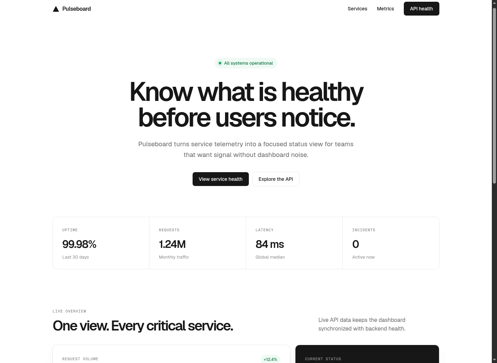

# Pulseboard

A zero-dependency service-health dashboard that pairs a responsive frontend with a small Python JSON API.



## Links

- **Repository:** https://github.com/hersaintel/pulseboard-demo
- **Hosted application:** Not deployed
- **Local frontend:** `http://127.0.0.1:8000`
- **Local backend health check:** `http://127.0.0.1:8000/api/health`
- **Local metrics API:** `http://127.0.0.1:8000/api/metrics`

## Features

- Live dashboard data loaded from the backend with the browser Fetch API.
- Service-level health, latency, uptime, request-volume, and incident indicators.
- Responsive layout for desktop and mobile screens.
- JSON health and metrics endpoints with explicit error responses.
- Python standard-library server with no third-party runtime dependencies.
- Automated HTTP integration tests for the frontend and API routes.

## Tech Stack

- **Frontend:** HTML5, CSS3, vanilla JavaScript
- **Backend:** Python 3 `http.server` and `socketserver`
- **API format:** JSON over HTTP
- **Testing:** Python `unittest` with real HTTP requests
- **Design direction:** Monochrome developer-tool interface with Geist typography

## Architecture

```text
Browser
  │
  ├── GET / ───────────────► Static HTML, CSS, and JavaScript
  │
  └── GET /api/metrics ────► Python HTTP server ───► JSON dashboard data
            │
            └── Frontend renders metrics, traffic bars, and service status
```

The Python process serves both the static frontend and the read-only API, which keeps local setup to one command and avoids cross-origin configuration.

## Getting Started

### Prerequisites

- Python 3.10 or newer
- A modern web browser

### Installation

```bash
git clone https://github.com/hersaintel/pulseboard-demo.git
cd pulseboard-demo
```

No package installation is required.

### Run Locally

```bash
python3 server.py
```

Open `http://127.0.0.1:8000` in your browser.

Use a different host or port when needed:

```bash
python3 server.py --host 0.0.0.0 --port 8080
```

## API Reference

### Health Check

```http
GET /api/health
```

Response:

```json
{"service":"pulseboard-api","status":"ok"}
```

### Dashboard Metrics

```http
GET /api/metrics
```

Response shape:

```json
{
  "summary": {
    "uptime": "99.98%",
    "requests": "1.24M",
    "latency": "84 ms",
    "incidents": 0
  },
  "services": [
    {
      "name": "Public API",
      "status": "Operational",
      "latency": "76 ms"
    }
  ],
  "traffic": [42, 55, 48, 68]
}
```

Unknown `/api/*` routes return a JSON `404` response.

## Testing

Run the complete test suite from the repository root:

```bash
python3 -m unittest discover -s tests -v
```

Validate Python syntax separately:

```bash
python3 -m py_compile server.py
```

The test suite starts the real HTTP server on an available local port and verifies:

- the frontend page loads;
- the health endpoint response;
- the dashboard metrics payload;
- JSON handling for unknown API routes.

## Project Structure

```text
pulseboard-demo/
├── docs/
│   └── images/
│       └── pulseboard-dashboard.png
├── public/
│   ├── app.js
│   ├── index.html
│   └── styles.css
├── tests/
│   └── test_server.py
├── .gitignore
├── LICENSE
├── README.md
└── server.py
```

## Deployment

The project is not currently hosted. It can run on any Python-capable service that allows binding to the platform-provided port. A deployment should execute `python3 server.py --host 0.0.0.0 --port <PORT>` and expose the selected port over HTTP.

## Roadmap

- Replace demonstration metrics with a persistent data source.
- Add configurable service checks and incident history.
- Publish a hosted demo and include its verified frontend and API URLs.
- Add continuous integration for the test suite.

## Contributing

1. Fork the repository.
2. Create a focused feature branch.
3. Add or update tests for behavior changes.
4. Run the complete test suite.
5. Open a pull request with a concise description and screenshots for visual changes.

## License

Licensed under the [MIT License](LICENSE).

## Author

Built by [@hersaintel](https://github.com/hersaintel).
